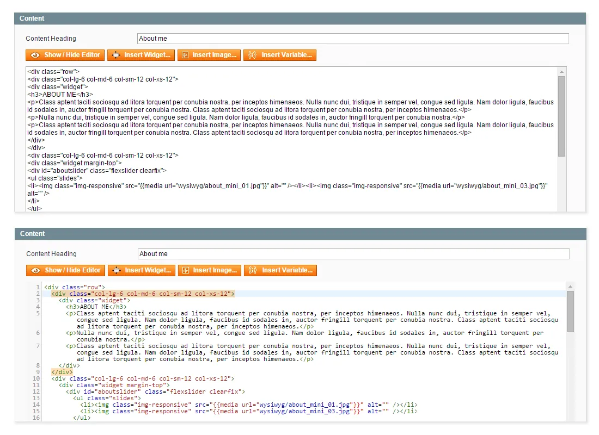
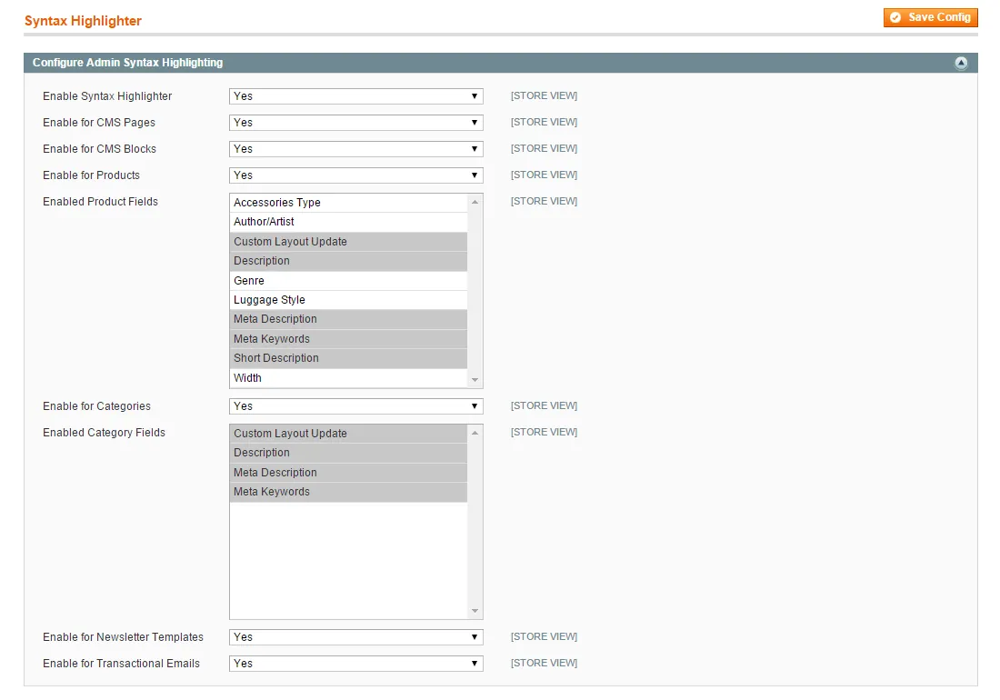
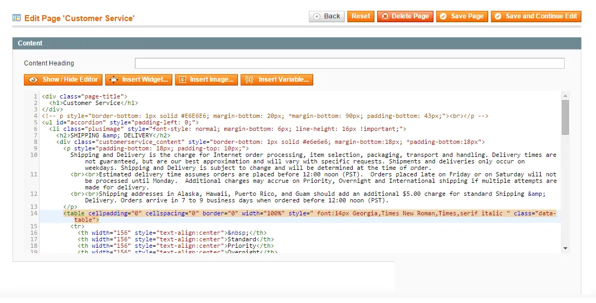
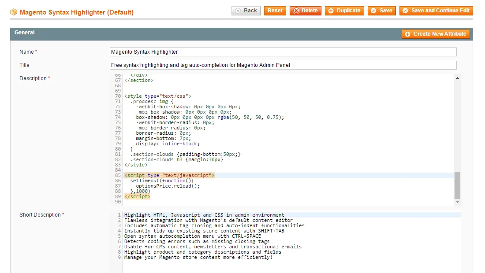
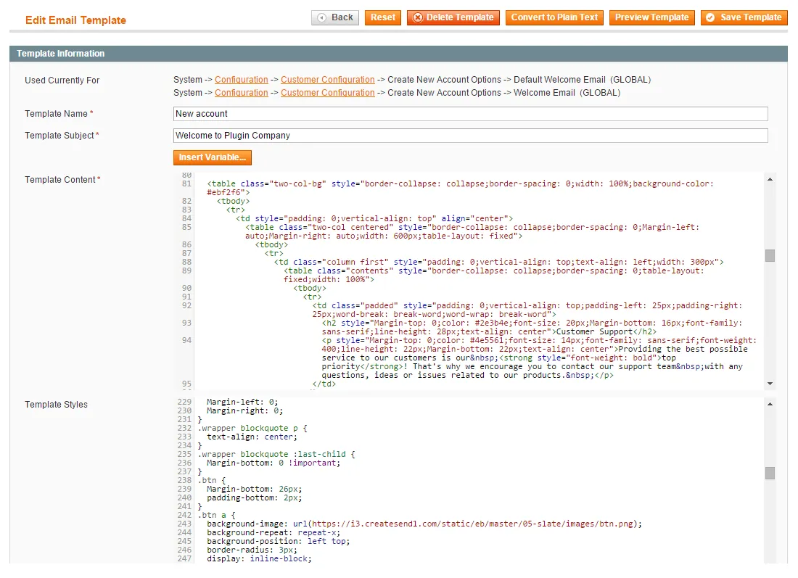
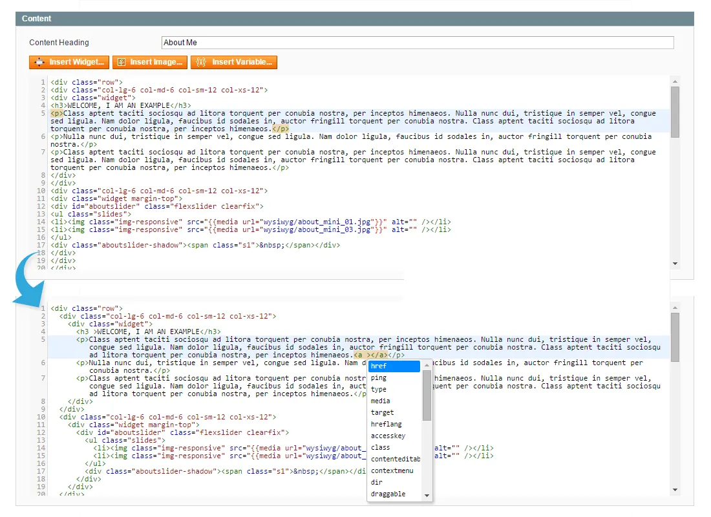

# Syntax Highlighter for Magento 1 / OpenMage

**Syntax highlighting for HTML, CSS and JavaScript in the Magento admin.**



Adds a code editor with syntax highlighting for HTML, JavaScript and CSS to the Magento admin.

Includes auto-indent, tag closing and auto-completion, for CMS content, newsletters, transactional e-mails and product and category descriptions.

> [!NOTE]
> Syntax Highlighter is free and open source under the MIT License (since 2026). Plugin Company no longer actively develops this extension, but issues and pull requests are welcome.

## Features

- Highlights HTML, JavaScript and CSS in the admin
- Integrates with Magento's default content editor
- Automatic tag closing and auto-indent
- Reformat existing content with Shift+Tab
- Auto-completion menu with Ctrl+Space
- Detects errors such as missing closing tags
- CMS content, newsletters and transactional e-mails
- Product and category descriptions and fields

## Screenshots

<table>
  <tr>
    <td width="50%" valign="top"><br><sub>Configure Syntax Highlighter settings</sub></td>
    <td width="50%" valign="top"><br><sub>CMS page with Syntax Highlighter</sub></td>
  </tr>
  <tr>
    <td width="50%" valign="top"><br><sub>Product page with Syntax Highlighter</sub></td>
    <td width="50%" valign="top"><br><sub>Transactional e-mail with Syntax Highlighter</sub></td>
  </tr>
  <tr>
    <td width="50%" valign="top"><br><sub>Syntax Highlighter features</sub></td>
    <td width="50%"></td>
  </tr>
</table>

## Compatibility

- **Magento:** Community Edition 1.4.x – 1.9.x, Enterprise Edition 1.8.x – 1.14.x
- **Latest version:** 1.0.3 (released 2016-05-02)
- **Composer package:** `plugincompany/magento1-syntax-highlighter`
- **Module:** `Plugincompany_Syntaxhighlighter`

## Installation

### modman

```bash
cd /path/to/magento
modman init   # once per Magento installation
modman clone https://github.com/PluginCompany/magento1-syntax-highlighter.git
```

modman creates symlinks, so enable *Allow Symlinks* under System > Configuration > Advanced > Developer > Template Settings.

### Composer

With [magento-hackathon/magento-composer-installer](https://github.com/Cotya/magento-composer-installer) (it reads the `modman` file of this repository):

```bash
composer config repositories.plugin.company composer https://plugin.company/
composer require plugincompany/magento1-syntax-highlighter
```

Your project `composer.json` needs the Magento root directory in its `extra` section (and, with Composer 2.2+, the installer plugin allowed), for example:

```json
{
    "extra": { "magento-root-dir": "./" },
    "config": { "allow-plugins": { "magento-hackathon/magento-composer-installer": true } }
}
```

### Manual installation

Download the ZIP of the latest release from the [tags page](https://github.com/PluginCompany/magento1-syntax-highlighter/tags) ([1.0.3](https://github.com/PluginCompany/magento1-syntax-highlighter/archive/refs/tags/1.0.3.zip)) and copy the `app/`, `js/` folders into your Magento root:

```bash
unzip magento1-syntax-highlighter-1.0.3.zip
cp -R magento1-syntax-highlighter-1.0.3/app magento1-syntax-highlighter-1.0.3/js /path/to/magento/
```

Step-by-step instructions are in the [installation guide](docs/02-installing-the-magento-extension.md).

### After installing

Clear the cache (System > Cache Management, or `rm -rf var/cache/*`), then log out of the admin and log in again so the new configuration sections and permissions are loaded.

> [!NOTE]
> Some files of this extension are also shipped by other Plugin Company Magento 1 extensions: `js/plugincompany/codemirror` (also in magento1-custom-contact-forms); `js/plugincompany/jquerynoconflict.js` (also in 8 other extensions). The original ZIP packages simply overwrote each other's copy; with modman or the Composer installer the second extension reports an existing target for these paths.

## Documentation

- [Documentation in this repository](docs/README.md) (Installation Guide, User Manual)
- Online documentation: <https://plugin.company/knowledge-base/docs/magento-syntax-highlighter/>
- Product page: <https://plugin.company/magento1-extensions/syntax-highlighter.html>

## Changelog

See [CHANGELOG.md](CHANGELOG.md) for the release history.

## Contributing

Found a bug or have an improvement? Please open an [issue](https://github.com/PluginCompany/magento1-syntax-highlighter/issues) or send a [pull request](https://github.com/PluginCompany/magento1-syntax-highlighter/pulls). Since the extension is no longer actively developed by Plugin Company, fixes from the community are the best way to keep it working on current Magento 1 / OpenMage and PHP versions.

## License

Plugin Company's code in this repository is released under the [MIT License](LICENSE), Copyright (c) 2014-2026 Plugin Company.

Bundled third-party libraries keep their own licenses; see [THIRD-PARTY-NOTICES.md](THIRD-PARTY-NOTICES.md) for the full list.
