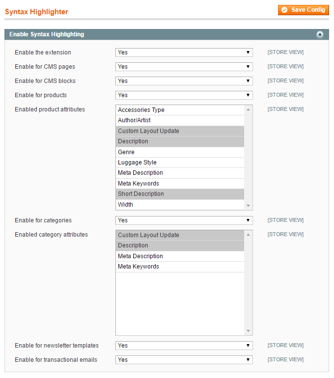

# Configuring the Syntax Highlighter Extension

To configure the extension, navigate to **System > Configuration** in the top Admin Panel menu and select 'Syntax Highlighter' from the left side menu.

Using the extension's config screen you can separately enable the Syntax Highlighter for back-end CMS pages, CMS blocks, products, categories, newsletter templates and transactional e-mails.

If syntax highlighting is enabled for product and/or category admin pages, you can specify for which text attributes the extension should be used.

It's possible to configure the extension per store view by changing the 'Current Configuration Scope' at the top left corner of the screen.

To save any changes made in the Syntax Highlighter settings, click the 'Save Config' button in the top right corner of the configuration screen.

---

[Documentation index](./README.md) · [README](../README.md) · [Online version](https://plugin.company/knowledge-base/docs/magento-syntax-highlighter/user-manual/configuring-the-syntax-highlighter-extension/)
