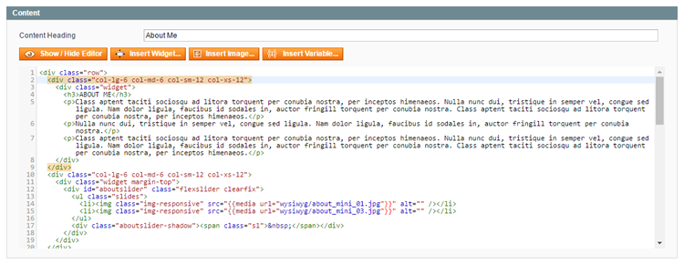
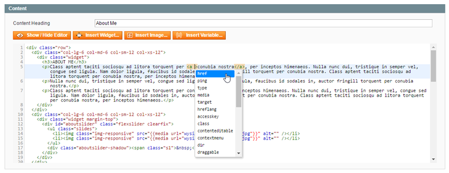

# Using the Syntax Highlighter

The Syntax Highlighter extension upgrades the default black and white text editor in the Magento Admin Panel to a fully syntax highlighted content editor, making it easier for admin users to read, write and organize text and source code in the back-end.

## Compatible Content Editors

By enabling the extension, syntax highlighting can be used in the content editors and selected text attribute fields of the following admin areas:

- CMS pages (**CMS > Pages**)
- CMS blocks (**CMS > Static Blocks**)
- Products (**Catalog > Manage Products**)
- Categories (**Catalog > Manage Categories**)
- Newsletter templates (**Newsletter > Newsletter Templates**)
- Transactional e-mails (**System > Transactional Emails**)

## Highlighting HTML, Javascript and CSS

The extension automatically displays HTML, Javascript and CSS in different colors while normal text remains black.

Selected content is highlighted in blue, while corresponding opening and closing tags are highlighted in red when focused on.

## Auto Indenting & Tag Closing

Magento Syntax Highlighter automatically closes tags and adds indents where necessary.

You can instantly organize existing content by selecting it (CTRL+A) and pressing SHIFT+TAB.

## Code Completion Menu

Press CTRL+SPACE in HTML, CSS or Javascript to open the code completion menu.

## Syntax Error Detection

The Syntax Highlighter automatically detects syntax errors such as missing tags which are indicated with a bright red color.

## Full Screen Editing

Press F11 to open the content editor in full screen.

---

[Documentation index](./README.md) · [README](../README.md) · [Online version](https://plugin.company/knowledge-base/docs/magento-syntax-highlighter/user-manual/using-the-syntax-highlighter/)
